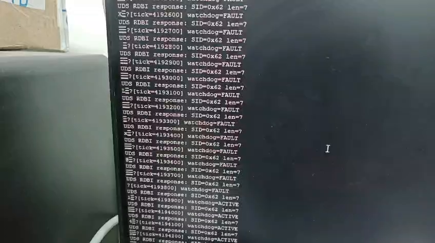

# System Health Platform for STM32

A small, dependency-free **logging + software-watchdog + UDS-inspired
diagnostics** platform for bare-metal STM32 (tested against Nucleo-F446RE),
built to study and honestly replicate architectural patterns from Bosch's
real open-source and production embedded code.

This is a portfolio/learning project. It does not claim to be certified,
production-grade, or a copy of any Bosch source file — every design
decision below is cited against the specific real file that inspired it,
and the translation from that file's language/framework (C++/Bazel/ROS2)
into bare-metal C is my own work.

## Why this project exists

Before writing a line of code, I studied:
- Bosch Sensortec's real sensor driver API style (`BME280_SensorAPI`) —
  status-code returns, null-pointer checks, function-pointer hardware
  abstraction.
- Bosch's Eclipse S-CORE project (`eclipse-score/logging`,
  `eclipse-score/inc_diagnostics`, `eclipse-score/communication`) — a real,
  Bosch-led open-source implementation of AUTOSAR-adjacent automotive
  middleware (`score::mw::log`, `score::mw::com`, UDS/SOVD diagnostics).
- Bosch Research's `software_watchdogs` — a heartbeat/lease-based
  watchdog pattern used in Bosch's robotics safety work.

Rather than building a generic embedded project and calling it
"Bosch-inspired," every module here has a direct, named source of
inspiration, documented in that module's own header file.

## Architecture

```
┌─────────────────────────────────────────────┐
│              Application Layer               │
│         (example_main.c — your task code)     │
└───────────────┬─────────────┬────────────────┘
                │             │
      ┌─────────▼──────┐ ┌────▼─────────┐ ┌──────────────┐
      │   diag_log      │ │diag_watchdog │ │     diag      │
      │ (logging svc)   │ │(health svc)  │ │ (UDS diag svc)│
      └─────────────────┘ └──────────────┘ └───────┬──────┘
                                                     │ uses
                                                     ▼
                                              diag_log (for
                                              error reporting)
```

`diag` (the UDS-inspired service) depends on `diag_log` for internal error
reporting, matching how a real automotive diagnostic stack always has a
logging dependency. `diag_watchdog` is independent and can be used alone.

## Module 1 — `diag_log`: fixed-slot logging

**Inspired by:** [`eclipse-score/baselibs` — `score/mw/log`](https://github.com/eclipse-score/baselibs/tree/main/score/mw/log)
(README, `backend_table.h`, `file_recorder.cpp`)

- 8 pre-allocated log slots (matches mw::log's documented default
  `numberOfSlots = 8`), **zero dynamic memory allocation** anywhere.
- Three-phase API — `diag_log_start()` → `diag_log_write()` (repeatable)
  → `diag_log_stop()` — mirrors mw::log's `StartRecord`/`Log`/`StopRecord`
  split.
- Severity filtering happens **before** a slot is reserved, avoiding
  wasted memory on messages that would be discarded — same optimization
  as `FileRecorder::StartRecord()`.
- `LogLevel` enum values (`0x00`–`0x06`) match `score::mw::log::LogLevel`
  exactly.
- Tagged-union `log_value_t` is the C equivalent of mw::log's
  type-safe overloaded `Log(bool/uint8_t/float/...)` functions (C has no
  function overloading).

**Real behavior it demonstrates:** deterministic, bounded memory usage
under logging load — the same property mw::log's own README states as its
core motivation ("memory is only allocated within the initialization
phase").

## Module 2 — `diag_watchdog`: heartbeat/lease-based task monitoring

**Inspired by:** [`boschresearch/software_watchdogs`](https://github.com/boschresearch/software_watchdogs)
(`SimpleWatchdog` and `WindowedWatchdog` classes)

- A task is "registered" with a **lease** (max time between heartbeats)
  and a **max_misses** count.
- `max_misses = 1` reproduces their `SimpleWatchdog` (trip on first
  violation).
- `max_misses > 1` reproduces their `WindowedWatchdog` (tolerate N misses
  before faulting) — the two upstream C++ classes are unified here into
  one configurable parameter, since that parameter is genuinely the only
  behavioral difference between them.
- A fresh heartbeat (`diag_watchdog_pet()`) resets the miss counter to 0
  and clears a fault, exactly matching their heartbeat subscriber callback
  (`lease_misses_ = 0` on every successful receive).
- Their implementation relies on ROS2/DDS QoS liveliness and deadline
  policies (an OS-level pub-sub framework unavailable on bare-metal); this
  module reproduces the same *behavioral contract* using simple polled
  time comparison against `HAL_GetTick()`-style timestamps, the standard
  bare-metal watchdog technique.
- Fail-safe default: an invalid/unregistered task handle reports `FAULT`,
  never a false "healthy" state.

## Module 3 — `diag`: UDS-inspired diagnostic services

**Inspired by:** [`eclipse-score/inc_diagnostics`](https://github.com/eclipse-score/inc_diagnostics)
(`diag_api` crate — `DataResource`, `RoutineControl` traits) and the real
**ISO 14229 (UDS)** standard.

- Implements the real request/response byte layout for two actual UDS
  services:
  - **`0x22` ReadDataByIdentifier** — read a registered Data Identifier's
    current value.
  - **`0x31` RoutineControl** — start/stop a registered diagnostic
    routine.
- Uses real UDS conventions: positive response = SID + `0x40`; negative
  response = `0x7F`, echoed SID, negative-response-code (NRC).
- `diag_did_descriptor_t` (a DID + name + read function pointer) is the
  plain-C equivalent of S-CORE's `sovd::DataResource` +
  `DataResourceMetadata`.
- Every failure path is logged through `diag_log`, tying this module to
  Module 1.

**Explicit limitation, stated honestly:** this is not a certified or
complete UDS stack — no security access, no session control, no full NRC
table. It demonstrates the protocol shape correctly enough to exchange
real UDS-formatted bytes with a simulated tester, which is what
`example_main.c` shows.

## Testing

Every module has a dedicated unit test file, following the one-behavior-
per-test style seen throughout Bosch's own test suites (e.g.
`backend_table_test.cpp`, `runtime_test.cpp`), including explicit
boundary/failure-path tests, not just happy-path coverage.

A tiny (~70 line) dependency-free test framework (`test_framework.h`)
stands in for Google Test, which real Bosch/S-CORE code uses — GTest was
judged too heavy a dependency to pull in for a portfolio-scale project,
but the test *shape* (TEST macro, EXPECT_EQ/EXPECT_TRUE, pass/fail
summary) is deliberately similar.

**Current status: 43/43 tests passing** across all three modules, run on
host (not target) for fast iteration — the same host-then-target testing
philosophy used in real embedded/automotive development.

```
diag_log_test:      15/15 passing
diag_watchdog_test: 13/13 passing
diag_test:          15/15 passing
```

Requirement traceability (which test verifies which REQ-ID) is in
[`REQUIREMENTS.md`](./REQUIREMENTS.md).

## Building and running

### Host (tests + demo, no hardware)

```sh
make test     # 3 suites, 43 tests
make demo     # integrated UDS + watchdog demo
```

Built with `-std=c11 -Wall -Wextra -Wpedantic`: 0 warnings.

### Target (STM32CubeIDE, NUCLEO-F446RE)

1. Copy `core/*.h` to `Core/Inc` and `core/*.c` to `Core/Src`.
2. `diag_log.c` flushes over `huart2` automatically when `USE_HAL_DRIVER`
   is defined (CubeIDE defines it); on host it is a no-op.
3. Paste the sections from [`stm32/main_verified_user_code.c`](stm32/main_verified_user_code.c)
   into the matching `USER CODE` regions of `main.c`.
4. Serial terminal: ST-Link VCP, 115200 8N1.

## Project structure

```
core/       diag_log, diag_watchdog, diag (the modules)
tests/      unit tests + test_framework.h
examples/   example_main.c (host integration demo)
stm32/      main_verified_user_code.c (tested on board)
            main_fault_injection.c (B1 button + PC0 scope pin, run on board)
docs/evidence/   test logs, screenshots, fault-injection photos + video
REQUIREMENTS.md  requirement traceability
```

## Evidence

### Host unit tests (gcc) - [`host_unit_tests.txt`](docs/evidence/host_unit_tests.txt)

| Suite | Result |
|---|---|
| diag_log_test | 15 run, 0 failed |
| diag_watchdog_test | 13 run, 0 failed |
| diag_test | 15 run, 0 failed |

### Host demo - [`host_demo_output.txt`](docs/evidence/host_demo_output.txt)

```
Tester -> ECU (RDBI request)  [22 12 34]
ECU -> Tester (RDBI response) [62 12 34 08 55]
Tester -> ECU (RoutineControl start request)  [31 01 02 03]
ECU -> Tester (RoutineControl start response) [71 01 02 03]
After hang: watchdog state = FAULT, miss_count = 3
Tester -> ECU (RDBI, unknown DID) [22 99 99]
ECU -> Tester (negative response)  [7F 22 31]
```

### On real hardware (NUCLEO-F446RE, STM32CubeIDE)

| Check | Observed | Screenshot |
|---|---|---|
| Build | 0 errors, 0 warnings; text 11512 B, data 12 B, bss 2316 B | [01](docs/evidence/screenshots/01_build_0errors_0warnings.png) |
| Flash | "Download verified successfully" | [02](docs/evidence/screenshots/02_flash_download_verified.png) |
| Serial (COM16, 115200 8N1) | `[tick=...] watchdog=ACTIVE`, +100 ms per line | [03](docs/evidence/screenshots/03_putty_watchdog_active_ticks.png) |
| UDS 0x22 read of DID 0x1234 | `UDS RDBI response: SID=0x62 len=7` | [04](docs/evidence/screenshots/04_putty_uds_rdbi_response_0x62.png) |
| Project layout | all six module files in the project | [05](docs/evidence/screenshots/05_cubeide_project_explorer.png) |

Notes:
- The terminal can show a few garbage bytes between text lines. That is the raw
  record buffer that `diag_log_stop()` flushes to the same USART2 as the
  `sprintf` status lines. Cosmetic; it is not a baud-rate problem.
- `len=7` is the 3-byte positive-response header (`62 12 34`) plus the 4-byte tick value.

### Fault injection on hardware (B1 button + oscilloscope)

Holding the onboard **B1** button stops the main loop from petting the
watchdog (simulated hung task). `SCOPE_PIN` (PC0) is driven HIGH while the
watchdog is ACTIVE and LOW while it is in FAULT. Watchdog task config:
lease = 500 ms, max_misses = 2. Scope: Keysight DSOX1204A, Ch2 on PC0,
DC coupling, 1 V/div.

| Check | Observed | Evidence |
|---|---|---|
| Probe setup | Ch2 on PC0 | [photo](docs/evidence/fault_injection/01_test_setup_probe_on_PC0.png) |
| B1 released | PuTTY `watchdog=ACTIVE`, PC0 HIGH | [log](docs/evidence/fault_injection/04_putty_watchdog_ACTIVE.png) · [scope](docs/evidence/fault_injection/03_scope_PC0_HIGH_button_released.png) |
| B1 held | PuTTY `watchdog=FAULT` (UDS keeps answering), PC0 LOW | [log](docs/evidence/fault_injection/06_putty_watchdog_FAULT.png) · [scope](docs/evidence/fault_injection/02_scope_PC0_LOW_button_held.png) |
| B1 released again | state returns to `ACTIVE` (automatic recovery on next heartbeat) | [log](docs/evidence/fault_injection/06_putty_watchdog_FAULT.png) |
| Video | scope HIGH before press → LOW during press | [video](docs/evidence/video/fault_injection_demo.mp4) · [frame 1](docs/evidence/fault_injection/05_video_scope_HIGH_before_press.png) · [frame 2](docs/evidence/fault_injection/07_video_scope_LOW_during_press.png) |



Honest limits of this evidence:
- The UART log and the scope are in separate camera shots, not one frame.
- The exact time from last heartbeat to FAULT (expected about
  lease × max_misses ≈ 1000 ms) has not been measured yet.
- `stm32/main_fault_injection.c` is the fault-injection `main.c` used for this
  test; `stm32/main_verified_user_code.c` is the same file with the button and
  scope-pin code removed.

### Not yet verified

- UDS is only exercised over UART loopback on target (the request is built in
  firmware). Real CAN transport is not implemented.
- The `0x31` RoutineControl path is verified on host only.

## What this project is honestly *not*

- Not a copy of any Bosch source file — no Bosch source lines are
  reproduced; only architectural patterns, naming conventions, and
  standard protocol byte layouts (ISO 14229) are used.
- Not using licensed AUTOSAR tooling (Vector DaVinci, EB tresos) — those
  require enterprise licenses unavailable to a student; this project uses
  AUTOSAR-*adjacent* concepts (layered design, ara::com-style naming
  philosophy) implemented from scratch.
- Not MISRA-C certified or ISO 26262 ASIL-classified — see
  `REQUIREMENTS.md` for the explicit, honest scope limits.

## Author's note

Built as part of a focused study of Bosch's real embedded/automotive
engineering conventions ahead of applying for embedded-systems roles.
Every citation above links to a real, still-public repository — feel free
to check the source.
